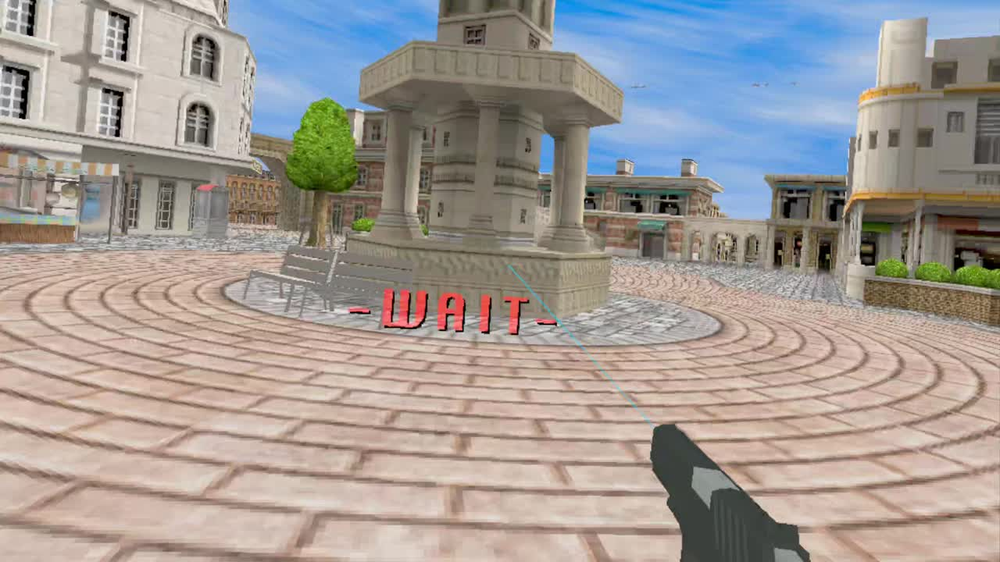

# Time Crisis II VR

Play the **arcade version of Time Crisis II** in VR on **Meta Quest 3** or a **Windows PC with an OpenXR headset**. Aim with tracked controllers, duck into cover, and use the arcade's scripted machine-gun pickups with a matching animated weapon model.

Built on the native System 23 reconstruction in **[spacestate1/namco22-decompile](https://github.com/spacestate1/namco22-decompile)**, with the OpenXR host and controller features adapted from [Time Crisis VR](https://github.com/DR-89/time-crisis-vr). This port uses the arcade US TSS3 Ver. B game, not the PlayStation 2 version.

**[Download v0.4.0](https://github.com/DR-89/time-crisis-2-vr/releases/tag/v0.4.0)** | [Quickstart](docs/QUICKSTART.md) | [PCVR setup](docs/PCVR.md) | [Development](docs/DEVELOPMENT.md)



*Actual Quest 3 recording. The headset renders a separate tracked view for each eye.*

## Online 2-player

**New in 0.4.0:** play the arcade's real **twin-cabinet mode** online, with voice chat. Each player runs the full game as Keith (P1) or Robert (P2), and the System 23 C422 link chip between the two cabinets is emulated and carried over the network. Quest, PCVR and desktop all play together. It is wire-compatible with the desktop Time Crisis 2 online play of [namco22-decompile](https://github.com/spacestate1/namco22-decompile) (0.9.3+, tested with 0.10.1), so VR and desktop players share rooms.

- **The menu's ONLINE tab** (left menu button):
  - **HOST A ROOM** shows a four-character room code; your friend picks **JOIN WITH CODE** and types it on the on-screen keyboard.
  - **BROWSE GAMES** lists the open rooms and local-network games, five to a page.
  - **LOCAL NETWORK** hosts on your Wi-Fi or VPN and joins by IP; **QUICK MATCH** joins anyone.
  - **Server → CHANGE** edits the lobby hostname/IP and optional port directly in the game. The keyboard starts in lowercase; **ABC / abc** switches case. **SAVE** applies and persists the address immediately; **DEFAULT** restores `zonesync.net`. Leave your room before changing servers.
  - The two games link automatically. While linked, the tab shows your partner, the link and voice chat.
  - **Left the game, restarted out of it or lost the connection?** **REJOIN** takes you back into that room, as the same cabinet, while it is still open, even after closing the app ([details](docs/ONLINE.md#coming-back-rejoin)).
- **Drop in, drop out:** the host plays at once with the arcade's own **SOLO/LINKED** ("SOLO START, BUT PERMITS 2P JOIN-IN"), and a friend can join that game whenever they arrive. Until then a stand-in answers on the link as an idle second cabinet, so no second game runs. Either player can leave mid-game and the other plays on.
- **Or straight from the arcade's own screen:** **SOLO/LINKED** is always open on SELECT GAME MODE. Put coins in and shoot it: the game starts at once and a room opens for it, with its code on screen. **SOLO ONLY** keeps the game to yourself. The menu never chooses for you: left alone, the arcade goes back to its intro with your coins kept, and the trigger brings the menu back.
- **Voice chat:** Opus; open mic with a voice gate (mute on the left stick click) or push to talk (hold a thumbstick click, V on a PC); echo cancellation and noise suppression on every headset and PC; partner volume and level meters.
- **Join with a credit:** a P2 who joins a game gets one credit to join with (once per session; continues take your own coins). A switch on the ONLINE tab.
- **Free to run:** the community lobby server relays rooms, so there are no accounts, no port forwarding and nothing to host.
- **While linked**, the game keeps running behind menus and with the headset off, and dropped partners reconnect by themselves.
- **Offline**, a stand-in answers on the link as an idle second cabinet, so SOLO/LINKED is open; taking it opens a room. SOLO ONLY plays exactly as before.

See **[docs/ONLINE.md](docs/ONLINE.md)** for setup, how it works and the test suite.

## Downloads and installation

| Platform | Download | Start playing |
| --- | --- | --- |
| Quest 3 standalone | [TimeCrisis2VR-v0.4.0-quest3.apk](https://github.com/DR-89/time-crisis-2-vr/releases/download/v0.4.0/TimeCrisis2VR-v0.4.0-quest3.apk) | Sideload with SideQuest or ADB, then open **Time Crisis II VR (Test)** under Unknown sources. |
| Windows x64 PCVR / desktop | [TimeCrisis2VR-v0.4.0-windows-x64.zip](https://github.com/DR-89/time-crisis-2-vr/releases/download/v0.4.0/TimeCrisis2VR-v0.4.0-windows-x64.zip) | Extract the entire ZIP. Connect your headset, then run **Play VR.cmd**. |

The release packages include the game files, Namco pistol, fallback pistol and machine-gun models, so no separate ZIP import is needed. The APK uses package `org.timecrisis2.arcadevr` and installs alongside the original Time Crisis VR. Updating an existing test build preserves local settings and cabinet data.

For ADB installation, enable Quest developer mode and accept USB debugging:

```powershell
adb install -r TimeCrisis2VR-v0.4.0-quest3.apk
```

For PCVR, connect the headset through **Virtual Desktop**, Quest Link, or another OpenXR setup **before** launching. An ADB cable connection alone is not a PCVR connection. The active runtime must support OpenGL. Virtual Desktop was tested with Quest 3; other runtimes remain unverified for this port. **Play SteamVR.cmd** selects a standard SteamVR installation for this app. **Play Desktop.cmd** runs without a headset.

After the arcade startup, press **A** for credits and then either **trigger** to start. Hold either **grip** to leave cover; release both to hide and reload.

## Features

**v0.4.0** adds online two-player, voice chat, the tabbed pause menu and an in-game server editor. The saved resolution presets, texture filtering and launcher artwork from [v0.3.3](docs/RELEASE_NOTES_0.3.3.md) remain available.

- Native arcade MIPS and H8 code translated to C, with the original textured world rendered from tracked stereo viewpoints.
- Standalone Quest and Windows PCVR builds, plus a normal desktop mode.
- Shoot with either hand: pressing a trigger moves the weapon to that controller.
- **Skip start-up** (PLAYER tab, off by default): shoot during the arcade's start-up (memory test, link countdown, parental advisory, logo) to run through it, silent. The arcade runs the same frames, only faster: about 5x on a PC, 2x on Quest 3, whose CPU emulates the memory test only at about its normal speed. Not while linked online.
- Grip-based cover or physical ducking, with upright-height calibration.
- Adjustable gun pitch from **-60 to +60 degrees**, plus saved **WORLD SIZE (25–400%)** and **VIEW DISTANCE (0–100 cm)**.
- Aim assistance cycles through **LASER / OFF / TRACER**. Tracer Squeeze flashes
  an orange ray for 65 ms on an accepted shot, using the existing surface hit.
- Martoscar's Namco Arcade Gun, with saved vertical/depth grip offsets.
- Select Keith's P1 or Robert's P2 route for the next app launch (experimental).
- Automatic pistol / Tripo3D machine-gun model changes using the arcade's actual weapon state.
- Whole-model recoil for the Namco gun, muzzle flash and controller vibration; the older fallback pistol retains its slide animation.
- HUD health, ammunition and player markers aligned on the same plane.
- Cinematic black bars removed in VR while retaining dialogue and transition text.
- Correct sRGB handling for arcade colors and refresh-rate selection from the runtime's supported rates.

## Controls

| Action | Default hand: right | Default hand: left |
| --- | --- | --- |
| Select weapon hand / shoot | Either trigger | Either trigger |
| Leave cover | Hold either grip | Hold either grip |
| Cover / reload | Release both grips | Release both grips |
| Insert credits | A, right controller | X, left controller |
| Cycle LASER / OFF / TRACER | B, right controller | Y, left controller |
| Recenter / calibrate upright height | X, left controller | A, right controller |
| Mute the microphone, while linked (open mic) | Left stick click | Left stick click |
| Talk, while linked (push to talk) | Hold either stick click | Hold either stick click |
| Open / close the menu | Left menu button | Left menu button |

The default hand determines the face-button layout. Trigger handoffs do not change that saved layout.

### The menu

The **left menu button** opens the menu. It appears in front of you and stays where it is while you look around it. Tabs across the top hold the settings; the buttons along the bottom are there on every tab:

- **RESUME** goes back to the game (so does the menu button).
- **RESTART GAME** restarts the arcade with its own TEST switch: about 10 seconds back to the intro, with your coins paid back in. While you are online it is **RESTART & LEAVE**, and REJOIN on the ONLINE tab brings you back.
- **RECENTER** sets where the cabinet is (stand upright: it calibrates physical ducking too).
- **RESTART APP** closes and reopens the app. Player and resolution changes need it; the button lights up when one is waiting.

**Point and shoot:** the gun's laser points at the menu and the trigger presses. Hold the trigger on a slider to drag it, or on its arrows to repeat. Pulling the other hand's trigger moves the gun to that hand.
**Or the sticks:** either stick moves the highlight and changes the highlighted setting; **A / X** selects, **B / Y** goes back, and the **grips** switch tabs (left: previous, right: next). The menu opens with **RESUME** highlighted, so menu then A resumes.
The line above the buttons explains whatever you point at. A setting off its default shows a reset button.

| Tab | Settings |
| --- | --- |
| GUN | Gun hand (the default), aim guide (laser / tracer / off), gun angle, gun height, gun depth |
| PLAYER | Player (P1 Keith / P2 Robert, after RESTART APP), take cover (grip / duck), world size, view distance, skip start-up (off by default) |
| GRAPHICS | Render resolution (after RESTART APP), texture filtering |
| AUDIO | Game volume (the arcade's sound; voice chat keeps its own), voice chat volume (also on ONLINE) |
| ONLINE | Host, join with a code, browse, quick match, local network, rejoin; your name, join with a credit, voice chat (open mic / push to talk / off); while linked, the session |

**Render resolution:** on **GRAPHICS**, choose **Default**, **1280 x 1344**, **1680 x 1760**, **2550 x 2640**, **2940 x 3080** or **3360 x 3520** pixels per eye, matching the NFSU VR ports. It saves at once and applies after **RESTART APP**; the running size is underlined. Default preserves the previous resolution (runtime recommendation capped at 1440 pixels on the longer side on Quest, 2160 on PCVR). Unsupported presets fall back to Default, and the tab says so. Higher resolutions require more GPU time and memory; the highest setting is not a performance recommendation.

**Texture filtering** defaults to **ON**, including when upgrading an older settings file, and switches at once. Filtering smooths world textures; HUD and text retain their existing sampling.

**World size** goes from **25% to 400%** in 5-point steps. Higher values make the world larger. The **100%** starting value is calibrated
against complete figures: Robert is about 1.70 m tall and two standing guards are
about 1.89 m in the measured opening scene. Existing saved percentages are retained; select 100% to try the calibration.

**View distance** goes from 0 to 100 cm in 5 cm steps (default **0 cm**). This adds
space between the camera and the world; it makes nearby cover appear smaller
without changing figure height.
Head movement, controller/weapon size, menu size and physical ducking
distances stay in real metres. Target rays follow the rendered surfaces after
either setting changes, including while paused.

For physical ducking, choose **DUCK** under **Take cover**, stand or sit upright and press **RECENTER**. Duck to hide/reload, then return upright to leave cover. If the gun points too high, lower **Gun angle**.

**New in v0.3.3:** Tracer Squeeze, the Namco gun, grip-fit controls and experimental Robert-route selection accompany the calibrated world-size fix.
On the **GUN** tab, positive **Gun height** raises the gun and positive
**Gun depth** pulls it towards your hand, in 5 mm steps up to 200 mm each way.
The offsets follow the controller and affect both the visible model and muzzle;
world size does not change them. Their zero point uses the new model's upper
grip; fine alignment with your controller or shell needs a headset check.
**Player: P2 ROBERT** (PLAYER tab) selects the original Robert route after
**RESTART APP**. This is standalone
play; the core still uses its local input/HUD slot and does not emulate a linked
second cabinet. See [implementation and validation details](docs/FEEDBACK-TEST.md).

The machine gun is equipped automatically during scripted sections, including Stage 1, Area 2. **Hold the trigger for automatic fire** while out of cover. There is no separate weapon-selection button. See [weapon details](docs/WEAPONS.md).

Desktop controls: mouse to aim, left mouse to shoot, right mouse or Space for cover/pedal, **5** for credits, and **Escape** for the menu. Online, **M** mutes an open mic and **V** held talks with push to talk. In the menu the mouse points and clicks; the arrows move and change, **Enter** selects, **Backspace** goes back and **Tab** / **Shift+Tab** switch tabs.

## Tested status and limitations

**v0.4.0 is experimental.** See the [release notes](https://github.com/DR-89/time-crisis-2-vr/releases/tag/v0.4.0) for checks on these exact packages and the remaining online-play limitations. A new headset playthrough has not been performed for this release.

Earlier-release validation: the Namco model and options were exercised on Quest 3; the runtime confirmed 120 Hz during the test startup. Both P1 and Robert-route replays completed 28,201 frames with zero CPU traps, floating-point exceptions or unknown C435 commands. Neither a full Robert-route playthrough nor sustained 120 FPS is established. The hardware and replay results below describe those earlier tests.

- **Quest 3:** immersive VR and gameplay tested. Health/ammunition alignment and automatic machine-gun switching were confirmed in headset. The runtime has confirmed 120 Hz in standalone sessions; short samples do not establish uninterrupted 120 FPS throughout the game or thermal stability.
- **Windows PCVR:** the earlier v0.2.0 was tested on Quest 3 through Virtual Desktop on 2026-10-10. The user confirmed VR and controls work and reported a successful playtest. The runtime confirmed **90 Hz**, **1980 x 2160 per eye**, on an **NVIDIA RTX 3050 Laptop GPU**. This is a short gameplay check, not a full-game performance benchmark.
- **Replay and graphics checks:** a corrected 28,201-frame replay completed with zero CPU traps, floating-point exceptions or unknown C435 commands. All 93 desktop comparison frames were pixel-identical after the transition fix; selected VR transition frames passed both-eye rendering checks. Those transition comparisons are from v0.2.0; see [validation details](docs/TRANSITIONS.md). New tests cover 21 menu variants, tracer lifetime/stereo, weapon rendering, grip offsets and paused scale changes.
- Quest 2/3S, other PC headsets and other OpenXR runtimes have not been confirmed for this release. Later stages, all effects, audio behavior and sustained performance need broader testing. Some rendering differences may remain.

The arcade simulation runs at approximately **59.906 Hz**. Headset presentation and tracking run at the selected headset rate. The app requests 120 Hz when offered, otherwise a supported lower rate; the Virtual Desktop test offered 90 Hz.

## Reporting problems

Open an [issue](https://github.com/DR-89/time-crisis-2-vr/issues) with the version, headset/runtime, stage/area and what happened. For a crash, preserve the logs before repeatedly relaunching.

- **Quest:** connect ADB and run `Export-Quest-Diagnostics.ps1` from this repository. It saves current/previous game logs, recorded inputs, settings and Android exit information locally. Review the files before attaching them to an issue.
- **Windows:** logs are `tc2.log` / `tc2-previous.log`; inputs are `tc2_last.rec` / `tc2_prev.rec` beside the executable.

Input recordings contain arcade controls, not video or headset poses. They do not embed the starting cabinet backup RAM, so an exact replay also needs matching cabinet settings. Reports are not uploaded automatically.

## Build from source

The provided scripts target Windows. Install Git, Python 3 and CMake. For Quest, also install a JDK and Android SDK platform 35, build-tools 35.0.1 and NDK 28.2.13676358, with the SDK available at `.tools/android-sdk`. The scripts fetch their pinned SDL, OpenXR, Ninja and Windows compiler dependencies.

```powershell
git clone --recurse-submodules https://github.com/DR-89/time-crisis-2-vr.git
cd time-crisis-2-vr
python -X utf8 tools/build_pc.py --rom "$env:USERPROFILE\Downloads\timecrs2.zip" --jobs 2
python -X utf8 tools/build.py --rom "$env:USERPROFILE\Downloads\timecrs2.zip" --bundle-roms --jobs 2
```

Set `JAVA_HOME` to your JDK before building Android. See [development instructions](docs/DEVELOPMENT.md) for SDK setup, tests and output paths. The preparer verifies all 22 required chip sizes and CRCs against the pinned upstream table. ROMs, signing keys and generated output are excluded from Git.

## Support development

If you enjoy this project and would like to support further development of my VR ports, you can support my work on Patreon:

[https://www.patreon.com/c/OpenSourceDevDirk](https://www.patreon.com/c/OpenSourceDevDirk)

## Credits and licensing

- **[spacestate1/namco22-decompile](https://github.com/spacestate1/namco22-decompile):** the System 23 reconstruction and shared engine that make this port possible. This release pins its `tc2/` core at [`8f2ed7f4`](https://github.com/spacestate1/namco22-decompile/tree/8f2ed7f4ed5c3fb5fecbbd29bbf6a6bf13876b2c/tc2) (0.10.1+).
- **[DR-89/time-crisis-vr](https://github.com/DR-89/time-crisis-vr/tree/v0.8.4):** the original port's OpenXR host, controller options and weapon rendering.
- **FireWarden:** CC0 [Lowpoly Pistol](https://opengameart.org/content/lowpoly-pistol), imported with separate animated parts.
- **Martoscar:** [Namco Arcade Gun](https://sketchfab.com/3d-models/namco-arcade-gun-15fbd5b9add94a34b5c21746e3dd32be),
  CC BY 4.0; converted with texture baking, grip calibration and recoil for this port.
- **Tripo3D:** user-supplied machine-gun model, optimized for this port.
- SDL2, Khronos OpenXR, zlib and other dependencies retain their original licenses.

The port code is MIT licensed. **Original Time Crisis II game code, graphics, sound, ROM contents and trademarks retain their original rights and are not covered by the MIT license.** This is an unofficial project, unaffiliated with Bandai Namco or Meta. See [NOTICE.md](NOTICE.md) for attribution and license scope.

Inherited TC1-specific files and historical documents are reference material, not TCII validation results. The active game source list is `quest/tc2_sources.cmake`.
