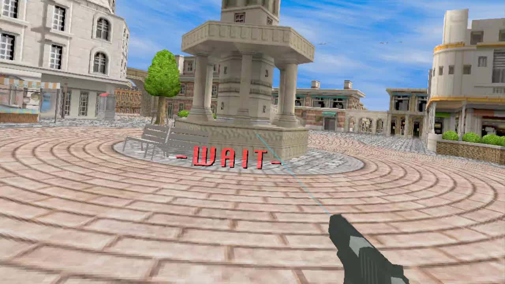

# Time Crisis II VR

Play the **arcade version of Time Crisis II** in VR on **Meta Quest 3** or a **Windows PC with an OpenXR headset**. Aim with tracked controllers, duck into cover, and use the arcade's scripted machine-gun pickups with a matching animated weapon model.

Built on the native System 23 reconstruction in **[spacestate1/namco22-decompile](https://github.com/spacestate1/namco22-decompile)**, with the OpenXR host and controller features adapted from [Time Crisis VR](https://github.com/DR-89/time-crisis-vr). This port uses the arcade US TSS3 Ver. B game, not the PlayStation 2 version.

**[Download v0.2.0](https://github.com/DR-89/time-crisis-2-vr/releases/tag/v0.2.0)** | [Quickstart](docs/QUICKSTART.md) | [PCVR setup](docs/PCVR.md) | [Development](docs/DEVELOPMENT.md)



*Actual Quest 3 recording. The headset renders a separate tracked view for each eye.*

## Downloads and installation

| Platform | Download | Start playing |
| --- | --- | --- |
| Quest 3 standalone | [TimeCrisis2VR-v0.2.0-quest3.apk](https://github.com/DR-89/time-crisis-2-vr/releases/download/v0.2.0/TimeCrisis2VR-v0.2.0-quest3.apk) | Sideload with SideQuest or ADB, then open **Time Crisis II VR (Test)** under Unknown sources. |
| Windows x64 PCVR / desktop | [TimeCrisis2VR-v0.2.0-windows-x64.zip](https://github.com/DR-89/time-crisis-2-vr/releases/download/v0.2.0/TimeCrisis2VR-v0.2.0-windows-x64.zip) | Extract the entire ZIP. Connect your headset, then run **Play VR.cmd**. |

The release packages include the game files and both weapon models, so no separate ZIP import is needed. The APK uses package `org.timecrisis2.arcadevr` and installs alongside the original Time Crisis VR. Updating an existing test build preserves local settings and cabinet data.

For ADB installation, enable Quest developer mode and accept USB debugging:

```powershell
adb install -r TimeCrisis2VR-v0.2.0-quest3.apk
```

For PCVR, connect the headset through **Virtual Desktop**, Quest Link, or another OpenXR setup **before** launching. An ADB cable connection alone is not a PCVR connection. The active runtime must support OpenGL. Virtual Desktop was tested with Quest 3; other runtimes remain unverified for this port. **Play SteamVR.cmd** selects a standard SteamVR installation for this app. **Play Desktop.cmd** runs without a headset.

After the arcade startup, press **A** for credits and then either **trigger** to start. Hold either **grip** to leave cover; release both to hide and reload.

## Features

- Native arcade MIPS and H8 code translated to C, with the original textured world rendered from tracked stereo viewpoints.
- Standalone Quest and Windows PCVR builds, plus a normal desktop mode.
- Shoot with either hand: pressing a trigger moves the weapon to that controller.
- Grip-based cover or physical ducking, with upright-height calibration.
- Adjustable gun pitch from **-60 to +60 degrees**, saved between sessions.
- Laser aiming assistance enabled by default, with a silent toggle.
- Automatic pistol / Tripo3D machine-gun model changes using the arcade's actual weapon state.
- Pistol slide animation, recoil, muzzle flash and controller vibration.
- HUD health, ammunition and player markers aligned on the same plane.
- Cinematic black bars removed in VR while retaining dialogue and transition text.
- Correct sRGB handling for arcade colors and refresh-rate selection from the runtime's supported rates.

## Controls

The default hand determines the face-button layout. Trigger handoffs do not change that saved layout.

| Action | Default hand: right | Default hand: left |
| --- | --- | --- |
| Select weapon hand / shoot | Either trigger | Either trigger |
| Leave cover | Hold either grip | Hold either grip |
| Cover / reload | Release both grips | Release both grips |
| Insert credits | A, right controller | X, left controller |
| Toggle laser | B, right controller | Y, left controller |
| Recenter / calibrate upright height | X, left controller | A, right controller |
| Open / close options | Left menu button | Left menu button |
| Change default hand, in options | Right stick click | Right stick click |
| Switch physical ducking / grip cover, in options | Y, left controller | B, right controller |
| Adjust gun angle, in options | Right stick up / down | Right stick up / down |
| Reset gun angle, in options | Left stick click | Left stick click |

For physical ducking, select that cover mode, stand or sit upright and use the recenter button. Duck to hide/reload, then return upright to leave cover. If the gun points too high, reduce **GUN ANGLE** in options.

The machine gun is equipped automatically during scripted sections, including Stage 1, Area 2. **Hold the trigger for automatic fire** while out of cover. There is no separate weapon-selection button. See [weapon details](docs/WEAPONS.md).

Desktop controls: mouse to aim, left mouse to shoot, right mouse or Space for cover/pedal, **5** for credits, and **Escape** for options.

## Tested status and limitations

**v0.2.0 is an experimental release of the tested `0.1.0-test.4` game code.** It has not been verified through a complete game.

- **Quest 3:** immersive VR and gameplay tested. Health/ammunition alignment and automatic machine-gun switching were confirmed in headset. The runtime has confirmed 120 Hz in standalone sessions; short samples do not establish uninterrupted 120 FPS throughout the game or thermal stability.
- **Windows PCVR:** tested on Quest 3 through Virtual Desktop on 2026-10-10. The user confirmed VR and controls work and reported a successful playtest. The runtime confirmed **90 Hz**, **1980 x 2160 per eye**, on an **NVIDIA RTX 3050 Laptop GPU**. This is a short gameplay check, not a full-game performance benchmark.
- **Replay and graphics checks:** a corrected 28,201-frame replay completed with zero CPU traps, floating-point exceptions or unknown C435 commands. All 93 desktop comparison frames were pixel-identical after the transition fix; selected VR transition frames passed both-eye rendering checks. See [validation details](docs/TRANSITIONS.md).
- Quest 2/3S, other PC headsets and other OpenXR runtimes have not been confirmed for this release. Later stages, all effects, audio behavior and sustained performance need broader testing. Some rendering differences may remain.

The arcade simulation runs at approximately **59.906 Hz**. Headset presentation and tracking run at the selected headset rate. The app requests 120 Hz when offered, otherwise a supported lower rate; the Virtual Desktop test offered 90 Hz.

## Reporting problems

Open an [issue](https://github.com/DR-89/time-crisis-2-vr/issues) with the version, headset/runtime, stage/area and what happened. For a crash, preserve the logs before repeatedly relaunching.

- **Quest:** connect ADB and run `Export-Quest-Diagnostics.ps1` from this repository. It saves current/previous game logs, recorded inputs, settings and Android exit information locally. Review the files before attaching them to an issue.
- **Windows:** logs are `tc2.log` / `tc2-previous.log`; inputs are `tc2_last.rec` / `tc2_prev.rec` beside the executable.

Input recordings contain arcade controls, not video or headset poses. They do not embed the starting cabinet backup RAM, so an exact replay also needs matching cabinet settings. Reports are not uploaded automatically.

## Build from source

The provided scripts target Windows. Install Git, Python 3 and CMake. For Quest, also install a JDK and Android SDK platform 35, build-tools 35.0.1 and NDK 28.2.13676358, with the SDK available at `.tools/android-sdk`. The scripts fetch their pinned SDL, OpenXR, Ninja and Windows compiler dependencies.

```powershell
git clone --recurse-submodules https://github.com/DR-89/time-crisis-2-vr.git
cd time-crisis-2-vr
python -X utf8 tools/build_pc.py --rom "$env:USERPROFILE\Downloads\timecrs2.zip" --jobs 2
python -X utf8 tools/build.py --rom "$env:USERPROFILE\Downloads\timecrs2.zip" --bundle-roms --jobs 2
```

Set `JAVA_HOME` to your JDK before building Android. See [development instructions](docs/DEVELOPMENT.md) for SDK setup, tests and output paths. The preparer verifies all 22 required chip sizes and CRCs against the pinned upstream table. ROMs, signing keys and generated output are excluded from Git.

## Credits and licensing

- **[spacestate1/namco22-decompile](https://github.com/spacestate1/namco22-decompile):** the System 23 reconstruction and shared engine that make this port possible. This release pins its `tc2/` core at [`0837a397`](https://github.com/spacestate1/namco22-decompile/tree/0837a397ebe554dbf5341d95629aa1e29fc58a52/tc2).
- **[DR-89/time-crisis-vr](https://github.com/DR-89/time-crisis-vr/tree/v0.8.4):** the original port's OpenXR host, controller options and weapon rendering.
- **FireWarden:** CC0 [Lowpoly Pistol](https://opengameart.org/content/lowpoly-pistol), imported with separate animated parts.
- **Tripo3D:** user-supplied machine-gun model, optimized for this port.
- SDL2, Khronos OpenXR, zlib and other dependencies retain their original licenses.

The port code is MIT licensed. **Original Time Crisis II game code, graphics, sound, ROM contents and trademarks retain their original rights and are not covered by the MIT license.** This is an unofficial project, unaffiliated with Bandai Namco or Meta. See [NOTICE.md](NOTICE.md) for attribution and license scope.

Inherited TC1-specific files and historical documents are reference material, not TCII validation results. The active game source list is `quest/tc2_sources.cmake`.
